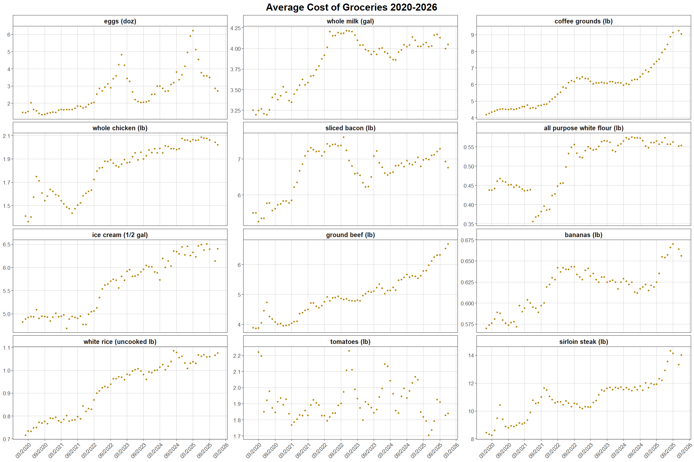

# U.S. Bureau of Labor Statistics in R

By Sameeksha Sharma


::: rmd-btn-wrapper
<a class="rmd-btn"
     href="https://github.com/UA-Libraries-Research-Data-Services/UALIB_ScholarlyAPI_Cookbook/blob/main/rmarkdown/bls.md"
     target="_blank"
     rel="noreferrer"> View RMarkdown File </a>
:::

The Bureau of Labor Statistics (BLS) API allows users to retrieve
official U.S. economic data directly into their programs instead of
manually downloading it from the BLS website. Users can request
information such as consumer prices (inflation), food and energy prices,
unemployment rates, wages, employment statistics, and other labor market
data by specifying the data series and time period they want. The API
returns the data in a structured format that can be easily analyzed.

*All data retrieved from BLS.gov API. BLS.gov cannot vouch for the data
or analyses derived from these data after the data have been retrieved
from BLS.gov.*

Please see the following resources for more information on API usage:

- Documentation
  - <a href="https://www.bls.gov/data/" target="_blank">BLS Data
    Finder</a>
  - <a href="https://www.bls.gov/developers/home.htm" target="_blank">BLS
    API Documentation</a>
- Terms
  - <a href="https://www.bls.gov/developers/termsOfService.htm" target="_blank">BLS
    API Terms of Service</a>
- Data Reuse
  - <a href="https://www.bls.gov/bls/linksite.htm" target="_blank">BLS
    Linking and Copyright Information</a>

***NOTE:*** Please see access details and rate limit requests for this
API in the official documentation.

*These recipe examples were tested on September 25, 2026.*

## Setup

The following packages need to be installed into your environment to run
the code examples in this tutorial. These packages can be installed with
`install.packages()`.

- <a href="https://cran.r-project.org/web/packages/httr/index.html" target="_blank">httr:
  HTTP Requests</a>

- <a href="https://cran.r-project.org/ges/jsonlite/index.html" target="_blank">jsonlite:
  A Simple and Robust JSON Parser and Generator for R</a>

- <a href="https://cran.r-project.org/web/packages/ggplot2/index.html" target="_blank">ggplot2:
  Create Elegant Data Visualisations Using the Grammar of Graphics</a>

- <a href="https://cran.r-project.org/web/packages/dplyr/index.html" target="_blank">dplyr:
  A Grammar of Data Manipulation</a>

- <a href="https://cran.r-project.org/web/packages/tidyr/index.html" target="_blank">tidyr:
  Tidy Messy Data</a>

We load the libraries used throughout this tutorial below:


``` r
library(httr)
library(jsonlite)
library(ggplot2)
library(dplyr)
```

```
## 
## Attaching package: 'dplyr'
```

```
## The following objects are masked from 'package:stats':
## 
##     filter, lag
```

```
## The following objects are masked from 'package:base':
## 
##     intersect, setdiff, setequal, union
```

``` r
library(tidyr)

options(stringsAsFactors = FALSE)
```

### Import Registration Key

Registration is not required to access the BLS API, but it is
recommended as it grants higher limits per day and allows users to use
the v2.0 API, which is used in this tutorial. You can sign up for one at
the
<a href="https://data.bls.gov/registrationEngine/" target="_blank">BLS
website</a>.

We keep our token in a `.Renviron` file that is stored in the working
directory and use `Sys.getenv()` to access it. The `.Renviron` should
have an entry like the one below.

``` text
BLS_API_KEY=PUT_YOUR_API_KEY_HERE
```

Below, we can test to whether the key was successfully imported.


``` r
API_KEY <- Sys.getenv("BLS_API_KEY")
if (nzchar(API_KEY)) {
  message("API key successfully loaded.")
} else {
  message("No API key found.")
}
```

```
## API key successfully loaded.
```

# 1. Find the Average Price of Eggs Over Time

The endpoints of the BLS API are found using the Series ID of the
specific dataset. These series IDs can be found
<a href="https://www.bls.gov/data/" target="_blank">here.</a>

Below, we'll build a POST request for the API to find the average price
of a dozen eggs each month from 2020 through September 2026.


``` r
URL <- 'https://api.bls.gov/publicAPI/v2/timeseries/data/'

# Series ID for average price of 'Eggs, grade A, large, per dozen'
series_id <- 'APU0000708111'

# The BLS API accepts a maximum 20-year span per request
start_year <- '2020'
end_year <- '2026'

payload <- list(
  seriesid = list(series_id),
  startyear = start_year,
  endyear = end_year
)
if (!is.null(API_KEY)) {
  payload$registrationkey <- API_KEY
}

response <- POST(
  URL,
  add_headers(`Content-Type` = 'application/json'),
  body = payload,
  encode = 'json'
)
# Status code 200 indicates success

status_code(response)
```

```
## [1] 200
```

``` r
result <- content(response, as = 'parsed', type = 'application/json')
```


``` r
data <- result$Results$series[[1]]$data

# Display number of results retrieved
length(data)
```

```
## [1] 80
```


``` r
# Display first 3 results
head(data, 3)
```

```
## [[1]]
## [[1]]$year
## [1] "2026"
## 
## [[1]]$period
## [1] "M08"
## 
## [[1]]$periodName
## [1] "August"
## 
## [[1]]$latest
## [1] "true"
## 
## [[1]]$value
## [1] "2.272"
## 
## [[1]]$footnotes
## [[1]]$footnotes[[1]]
## named list()
## 
## 
## 
## [[2]]
## [[2]]$year
## [1] "2026"
## 
## [[2]]$period
## [1] "M07"
## 
## [[2]]$periodName
## [1] "July"
## 
## [[2]]$value
## [1] "2.189"
## 
## [[2]]$footnotes
## [[2]]$footnotes[[1]]
## named list()
## 
## 
## 
## [[3]]
## [[3]]$year
## [1] "2026"
## 
## [[3]]$period
## [1] "M06"
## 
## [[3]]$periodName
## [1] "June"
## 
## [[3]]$value
## [1] "2.141"
## 
## [[3]]$footnotes
## [[3]]$footnotes[[1]]
## named list()
```

Now, we'll format the data above so that we can plot it with ggplot2.


``` r
# Store average price of eggs in (date, value) tuples
monthly_prices <- list()

for (data_point in data) {

  # Convert date to Date object for compatibility with ggplot2
  tryCatch({

    value <- as.numeric(data_point$value)

    date <- paste0(
      substr(data_point$period, 2, 3),
      "/",
      data_point$year
    )

    date <- as.Date(
      paste0(
        data_point$year,
        "-",
        substr(data_point$period, 2, 3),
        "-01"
      )
    )

    monthly_prices[[length(monthly_prices) + 1]] <-
      data.frame(
        date = date,
        value = value
      )

  }, warning = function(w) {

    # Accounting for missing data
    cat(
      "Skipping ",
      data_point$periodName,
      data_point$year,
      "-missing data\n",
      sep = ""
    )

    return(NULL)

  })
}
```

```
## Skipping October2025-missing data
```

``` r
# Combine all observations into a single data frame
monthly_prices <- do.call(rbind, monthly_prices)

# Display first 12 results
head(monthly_prices, 12)
```

```
##          date value
## 1  2026-08-01 2.272
## 2  2026-07-01 2.189
## 3  2026-06-01 2.141
## 4  2026-05-01 2.191
## 5  2026-04-01 2.250
## 6  2026-03-01 2.348
## 7  2026-02-01 2.500
## 8  2026-01-01 2.577
## 9  2025-12-01 2.712
## 10 2025-11-01 2.860
## 11 2025-09-01 3.488
## 12 2025-08-01 3.587
```

Now, we can graph the data in ggplot2:


``` r
library(ggplot2)

ggplot(monthly_prices, aes(x = date, y = value)) +
  
  # Plot average egg prices as red points
  geom_point(color = "red", size = 1.5) +
  
  # Title and axis labels
  labs(
    title = "Average Price of One Dozen of Eggs per Month",
    x = "Month",
    y = "Average Price in $"
  ) +
  
  # Format x-axis like 03/2020, 09/2020, etc.
  scale_x_date(
    date_labels = "%m/%Y",
    date_breaks = "6 months"
  ) +
  
  # Light gray gridlines similar to matplotlib
  theme_light() +
  
  theme(
    axis.text.x = element_text(angle = 30, hjust = 1),
    panel.grid.major = element_line(
      color = "lightgray",
      linewidth = 0.5
    )
  )
```



# 2.Find the Average Prices of Multiple Items

The BLS API allows users to query up to 25 series in a single request.
Below, we'll obtain the series data for multiple common household goods
in a single request:


``` r
# Series IDs for a variety of common groceries
series_ids <- c(
  "APU0000708111" = "eggs (doz)",
  "APU0000709112" = "whole milk (gal)",
  "APU0000717311" = "coffee grounds (lb)",
  "APU0000706111" = "whole chicken (lb)",
  "APU0000704111" = "sliced bacon (lb)",
  "APU0000701111" = "all purpose white flour (lb)",
  "APU0000710411" = "ice cream (1/2 gal)",
  "APU0000703112" = "ground beef (lb)",
  "APU0000711211" = "bananas (lb)",
  "APU0000701312" = "white rice (uncooked lb)",
  "APU0000712311" = "tomatoes (lb)",
  "APU0000703613" = "sirloin steak (lb)"
)

# The BLS API accepts a max of a 20 year span per request, and bounds are inclusive
start_year <- "2020"
end_year <- "2025"

# Build the JSON payload for the API request
payload <- list(
  seriesid = names(series_ids),
  startyear = start_year,
  endyear = end_year,
  registrationkey = API_KEY
)

# Submit the request to the BLS API
response <- POST(
  URL,
  add_headers(`Content-Type` = "application/json"),
  body = payload,
  encode = "json"
)

# Parse the JSON response and extract the series data
data_retrieved <- content(
  response,
  as = "parsed",
  type = "application/json"
)$Results$series

# Display number of series obtained
length(data_retrieved)
```

```
## [1] 12
```


``` r
# count the missing values 
missing_count <-0
# Determine the number of columns needed:
# one column for the date and one column for each grocery item
number_of_items <- length(series_ids) + 1

# Create the first row of the table
monthly_prices <- vector("list", 1)
monthly_prices[[1]] <- rep(0, number_of_items)
monthly_prices[[1]][1] <- "date"

# Create a row for each date using the first series
for (i in data_retrieved[[1]]$data) {
  
  monthly_prices[[length(monthly_prices) + 1]] <-
    rep(0, number_of_items)
  
  date <- paste0(
    substr(i$period, 2, 3),
    "/",
    i$year
  )
  
  monthly_prices[[length(monthly_prices)]][1] <- date
}

# Fill in item names and prices
for (i in seq_along(data_retrieved)) {
  
  item <- data_retrieved[[i]]
  
  # Get the grocery item name from the series ID
  item_name <- series_ids[item$seriesID]
  
  monthly_prices[[1]][i + 1] <- item_name
  
  for (j in seq_along(item$data)) {
    
    data_point <- item$data[[j]]
    
    value <- suppressWarnings(as.numeric(data_point$value))
    
    # Account for missing data
    if (is.na(value)) {
      missing_count <- missing_count +1
      
      next
    }
    
    monthly_prices[[j + 1]][i + 1] <- value
  }

}
if (missing_count >0){
  print("Skipping some months due to insufficient data")
}
```

```
## [1] "Skipping some months due to insufficient data"
```


``` r
# Convert monthly_prices list into a data frame
monthly_prices_df <- as.data.frame(
  do.call(rbind, monthly_prices),
  stringsAsFactors = FALSE
)

# Use the first row as column names
colnames(monthly_prices_df) <- monthly_prices_df[1, ]

# Remove the header row
monthly_prices_df <- monthly_prices_df[-1, ]

# Convert from wide format to long format
monthly_prices_long <- monthly_prices_df %>%
  pivot_longer(
    cols = -date,
    names_to = "item",
    values_to = "price"
  ) %>%
  mutate(
    
    # Convert MM/YYYY to Date format
    date = as.Date(
      paste0(
        substr(date, 4, 7),
        "-",
        substr(date, 1, 2),
        "-01"
      )
    ),
    
    # Convert price to numeric
    price = as.numeric(price)
    
  ) %>%
  
  # Remove missing values and zeros
  filter(
    !is.na(price),
    price != 0
  )

# Preserve the original grocery order
monthly_prices_long$item <- factor(
  monthly_prices_long$item,
  levels = colnames(monthly_prices_df)[-1]
)

# Create the plot
ggplot(
  monthly_prices_long,
  aes(x = date, y = price)
) +
  
  # Scatter points
  geom_point(
    color = "darkgoldenrod",
    size = 1.2
  ) +
  
  # 4 x 3 panel layout
  facet_wrap(
    ~ item,
    nrow = 4,
    ncol = 3,
    scales = "free_y"
  ) +
  
  # Format dates every 6 months
  scale_x_date(
    date_labels = "%m/%Y",
    date_breaks = "6 months"
  ) +
  
  labs(
    title = "Average Cost of Groceries 2020-2025",
    x = NULL,
    y = NULL
  ) +
  
  theme_bw() +
  
  theme(
    
    # Main title
    plot.title = element_text(
      hjust = 0.5,
      size = 18,
      face = "bold"
    ),
    
    # Grocery names
    strip.text = element_text(
      size = 12,
      face = "bold"
    ),
    
    # Date labels
    axis.text.x = element_text(
      angle = 45,
      hjust = 1,
      size = 10
    ),
    
    # Y-axis labels
    axis.text.y = element_text(
      size = 10
    ),
    
    # Grid styling
    panel.grid.major = element_line(
      color = "lightgray",
      linewidth = 0.3
    ),
    
    panel.grid.minor = element_blank(),
    
    strip.background = element_rect(
      fill = "white"
    )
  )
```


# 3. Find Yearly Earnings 1982-2026

For this example, we'll look at the earnings published by the BLS.

Since the span of years in this dataset is greater than 20, we'll first
create a function to split up a given year interval into a list of
intervals no greater than 20 years in length:


``` r
# Returns a list of (start_year, end_year) intervals no greater than
# 20 years apart, since that is the maximum span allowed in a single API request
generate_year_intervals <- function(start, end) {

  intervals <- list()

  while (start <= end) {

    if ((start + 19) < end) {

      intervals[[length(intervals) + 1]] <- c(
        as.character(start),
        as.character(start + 19)
      )

    } else {

      intervals[[length(intervals) + 1]] <- c(
        as.character(start),
        as.character(end)
      )

    }

    start <- start + 20
  }
  
  

  return(intervals)
}
```

Now, we can make a series of API requests over this interval.


``` r
# Series ID for '(unadj)- Median usual weekly earnings (second quartile),
# Employed full time, Wage and salary workers'
series_ids <- list("LEU0252881500")

# Starting and ending bounds for the data we want to retrieve
start <- 1982
end <- 2026

# Generate the 20-year intervals required by the BLS API
intervals <- generate_year_intervals(start, end)

# Store all observations returned by the API
data_retrieved <- list()

for (interval in intervals) {

  # Build the API request payload
  payload <- list(
    seriesid = series_ids,
    startyear = interval[[1]],
    endyear = interval[[2]],
    registrationkey = API_KEY
  )

  # Submit request to the BLS API
  response <- POST(
    URL,
    add_headers(`Content-Type` = "application/json"),
    body = payload,
    encode = "json"
  )

  # Parse the JSON response
  result <- content(
    response,
    as = "parsed",
    type = "application/json"
  )

  # Combine the lists returned from each query into a single list
  data_retrieved <- c(
    data_retrieved,
    result$Results$series[[1]]$data
  )

  # Wait 0.2 seconds between API calls to conform to the rate limits
  Sys.sleep(0.2)
}

# Display length of data
length(data_retrieved)
```

```
## [1] 178
```


``` r
# Display first 3 results
data_retrieved[1:3]
```

```
## [[1]]
## [[1]]$year
## [1] "2001"
## 
## [[1]]$period
## [1] "Q04"
## 
## [[1]]$periodName
## [1] "4th Quarter"
## 
## [[1]]$value
## [1] "606"
## 
## [[1]]$footnotes
## [[1]]$footnotes[[1]]
## named list()
## 
## 
## 
## [[2]]
## [[2]]$year
## [1] "2001"
## 
## [[2]]$period
## [1] "Q03"
## 
## [[2]]$periodName
## [1] "3rd Quarter"
## 
## [[2]]$value
## [1] "596"
## 
## [[2]]$footnotes
## [[2]]$footnotes[[1]]
## named list()
## 
## 
## 
## [[3]]
## [[3]]$year
## [1] "2001"
## 
## [[3]]$period
## [1] "Q02"
## 
## [[3]]$periodName
## [1] "2nd Quarter"
## 
## [[3]]$value
## [1] "592"
## 
## [[3]]$footnotes
## [[3]]$footnotes[[1]]
## named list()
```

Now, let's format the data to be graphed.


``` r
# Store yearly earnings in (date, earnings) tuples
yearly_earnings <- list()

for (data_point in data_retrieved) {

  # Keep only first-quarter observations
  if (data_point$period != "Q01") {
    next
  }

  # Put date in MM/YYYY notation and convert to a Date object
  date <- paste0("01/", data_point$year)

  date <- as.Date(
    paste0(data_point$year, "-01-01")
  )

  # Multiply weekly earnings by 52 to approximate annual salary
  salary <- as.numeric(data_point$value) * 52

  yearly_earnings[[length(yearly_earnings) + 1]] <-
    data.frame(
      date = date,
      salary = salary
    )
}

# Combine all observations into a single data frame
yearly_earnings <- do.call(rbind, yearly_earnings)

# Display first 5 results
head(yearly_earnings, 5)
```

```
##         date salary
## 1 2001-01-01  30628
## 2 2000-01-01  29796
## 3 1999-01-01  27976
## 4 1998-01-01  27092
## 5 1997-01-01  26208
```

Now, let's graph this data with a scatter plot.


``` r
# Create scatter plot of yearly earnings
ggplot(
  yearly_earnings,
  aes(x = date, y = salary)
) +
  
  # Plot yearly earnings as green points
  geom_point(
    color = "green",
    size = 1.5
  ) +
  
  # Format x-axis to display years
  scale_x_date(
    date_labels = "%Y",
    date_breaks = "5 years"
  ) +
  
  labs(
    title = "Median Yearly Earnings for 'Employed full time, Wage and salary workers'",
    x = "Year",
    y = "Median Yearly Earnings in $"
  ) +
  
  # Create light gray gridlines and white background
  theme_bw() +
  
  theme(
    plot.title = element_text(
      hjust = 0.5,
      size = 14
    ),
    
    panel.grid.major = element_line(
      color = "lightgray",
      linewidth = 0.5
    ),
    
    panel.grid.minor = element_blank(),
    
    axis.text.x = element_text(
      angle = 45,
      hjust = 1
    )
  )
```


# 4. Finding the Unemployment Rate 1948-2026

For our final example, we'll graph the unemployment rate going back to
1948.


``` r
# Series ID for the unemployment rate
series_ids <- list("LNS14000000")

# The BLS API accepts a max of a 20 year span per request,
# and the start and end years are inclusive
start <- 1948
end <- 2026

# Generate the year intervals
intervals <- generate_year_intervals(start, end)

# Store all observations returned by the API
data_retrieved <- list()

for (interval in intervals) {

  # Build API request payload
  payload <- list(
    seriesid = series_ids,
    startyear = interval[[1]],
    endyear = interval[[2]],
    registrationkey = API_KEY
  )

  # Submit request to the BLS API
  response <- POST(
    URL,
    add_headers(`Content-Type` = "application/json"),
    body = payload,
    encode = "json"
  )

  # Parse the JSON response
  result <- content(
    response,
    as = "parsed",
    type = "application/json"
  )

  # Combine the lists returned from each query into a single list
  data_retrieved <- c(
    data_retrieved,
    result$Results$series[[1]]$data
  )

  # Wait 0.2 seconds between API calls to conform to rate limits
  Sys.sleep(0.2)
}

# Display length of data
length(data_retrieved)
```

```
## [1] 936
```


``` r
# Display first 3 data entries
data_retrieved[1:3]
```

```
## [[1]]
## [[1]]$year
## [1] "1967"
## 
## [[1]]$period
## [1] "M12"
## 
## [[1]]$periodName
## [1] "December"
## 
## [[1]]$value
## [1] "3.8"
## 
## [[1]]$footnotes
## [[1]]$footnotes[[1]]
## named list()
## 
## 
## 
## [[2]]
## [[2]]$year
## [1] "1967"
## 
## [[2]]$period
## [1] "M11"
## 
## [[2]]$periodName
## [1] "November"
## 
## [[2]]$value
## [1] "3.9"
## 
## [[2]]$footnotes
## [[2]]$footnotes[[1]]
## named list()
## 
## 
## 
## [[3]]
## [[3]]$year
## [1] "1967"
## 
## [[3]]$period
## [1] "M10"
## 
## [[3]]$periodName
## [1] "October"
## 
## [[3]]$value
## [1] "4.0"
## 
## [[3]]$footnotes
## [[3]]$footnotes[[1]]
## named list()
```

Now, let's format and filter the data returned from the API request for
graphing, For this graph, we'll only consider the unemployment rates
reported in January, April, July, and October (except for 2025 which will have November).


``` r
# Store the unemployment rate data in (date, rate) tuples
unemployment_rates <- list()

# Count skipped observations
missing_count <- 0

for (data_point in data_retrieved) {

  # Keep January, April, July, and October
  # Also keep November 2025 as a substitute because October 2025 is unavailable
  if (!(data_point$period %in% c("M01", "M04", "M07", "M10") ||
        (data_point$period == "M11" && data_point$year == "2025"))) {
    next
  }

  # Put date in MM/YYYY notation and convert date to a Date object
  date <- paste0(
    substr(data_point$period, 2, 3),
    "/",
    data_point$year
  )

  date <- as.Date(
    paste0(
      data_point$year,
      "-",
      substr(data_point$period, 2, 3),
      "-01"
    )
  )

  # Convert the unemployment rate to a numeric value
  rate <- suppressWarnings(as.numeric(data_point$value))

  # Account for missing data
  if (is.na(rate)) {

    missing_count <- missing_count + 1

    next
  }

  unemployment_rates[[length(unemployment_rates) + 1]] <-
    data.frame(
      date = date,
      rate = rate
    )
}

# Report skipped observations once
if (missing_count > 0) {
  cat(
    "Skipped",
    missing_count,
    "observations because data was unavailable.\n"
  )
}
```

```
## Skipped 1 observations because data was unavailable.
```

``` r
# Combine all observations into a single data frame
unemployment_rates <- do.call(rbind, unemployment_rates)

# Display first 5 results
head(unemployment_rates, 5)
```

```
##         date rate
## 1 1967-10-01  4.0
## 2 1967-07-01  3.8
## 3 1967-04-01  3.8
## 4 1967-01-01  3.9
## 5 1966-10-01  3.7
```


``` r
# Create scatter plot of unemployment rates
ggplot(
  unemployment_rates,
  aes(x = date, y = rate)
) +
  
  # Plot unemployment rates as tomato-colored points
  geom_point(
    color = "tomato",
    size = 1.5
  ) +
  
  # Format x-axis to display years every 5 years
  scale_x_date(
    date_labels = "%Y",
    date_breaks = "5 years"
  ) +
  
  # Match Python y-axis limits
  scale_y_continuous(
    limits = c(
      0,
      ceiling(max(unemployment_rates$rate)) + 1
    )
  ) +
  
  labs(
    title = "Unemployment Rate",
    x = "Year",
    y = "Unemployment Rate"
  ) +
  
  # White background with light gray gridlines
  theme_bw() +
  
  theme(
    
    # Center title
    plot.title = element_text(
      hjust = 0.5,
      size = 14,
      face = "bold"
    ),
    
    # Rotate year labels similar to autofmt_xdate()
    axis.text.x = element_text(
      angle = 45,
      hjust = 1
    ),
    
    panel.grid.major = element_line(
      color = "lightgray",
      linewidth = 0.5
    ),
    
    panel.grid.minor = element_blank()
    
  )
```


